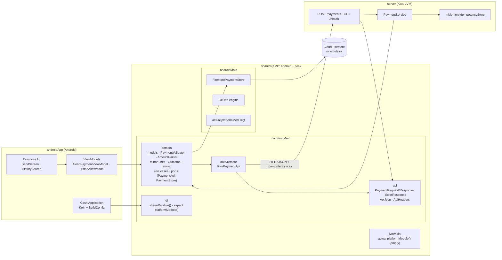
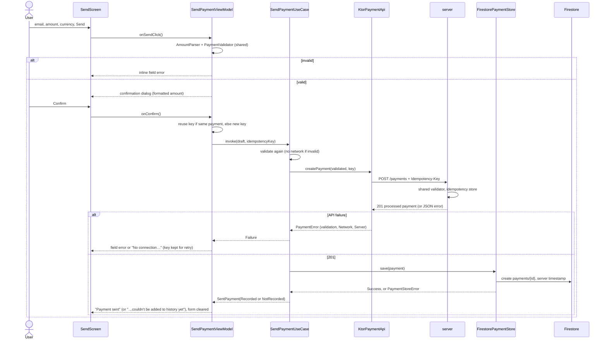
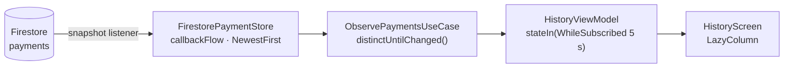

# Architecture

How the Cashi Payment App is structured, how a payment flows through it, and what another platform
(iOS) would need. For setup and commands see the [README](../README.md); for the HTTP contract see
[API.md](API.md).

**Contents:** [Overview](#overview) · [Modules and layers](#modules-and-layers) ·
[Send-payment flow](#send-payment-flow) · [History flow](#history-flow) ·
[expect/actual and platform boundaries](#expectactual-and-platform-boundaries) ·
[Error model](#error-model) · [Idempotency end to end](#idempotency-end-to-end) ·
[Testing map](#testing-map) · [Cross-platform potential (iOS)](#cross-platform-potential-ios)

## Overview



- **`shared`** holds everything that isn't UI: the domain, the use cases, the API client and the
  API contract. Its `jvm()` target exists for the **server**, which reuses the same validator,
  money conversion and request/response models, so client and server rules can't drift apart.
- **`androidApp`** is presentation only: Compose screens, thin ViewModels, and the Koin start-up
  where build-specific values (`BuildConfig`) enter the graph.
- **Firebase lives only in `shared/androidMain`.** `commonMain` and the server never see it.

## Modules and layers

| Layer | Where | Contents | May depend on |
|---|---|---|---|
| Domain | `shared/commonMain/…/domain` | `Payment`, `PaymentDraft`, `ValidatedPayment`, `Currency`, `IdempotencyKey`, `SentPayment`; `PaymentValidator`, `AmountParser`; `toMinorUnits` / `toMajorUnits`; `Outcome`; `PaymentError`, `PaymentStoreError`; `SendPaymentUseCase`, `ObservePaymentsUseCase`; ports `PaymentApi`, `PaymentStore` | Kotlin stdlib and coroutines only |
| API contract | `shared/commonMain/…/api` | `PaymentRequest`, `PaymentResponse`, `ErrorResponse`, `ApiErrorCode`, `ApiHeaders`, `ApiJson`, `StrictJsonDoubleSerializer` | kotlinx.serialization |
| Data | `shared/commonMain/…/data/remote`, `shared/androidMain/…/data` | `KtorPaymentApi` (+ error mapping, timeouts), `createOkHttpEngine()`, `FirestorePaymentStore` (+ document mapping), `createFirestorePaymentStore()` | Domain, API contract, Ktor, Firebase (androidMain only) |
| DI | `shared/…/di` | `sharedModule()`, `PaymentConfig`, `expect fun platformModule()` with Android and JVM actuals | All of the above, Koin |
| Presentation | `androidApp` | `SendScreen` / `HistoryScreen` (stateless content + thin wrappers), `SendPaymentViewModel`, `HistoryViewModel`, `AmountFormatter`, `TimestampFormatter`, navigation | Domain use cases and models only (never data classes or Firebase), Compose, Koin |
| Backend | `server` | Routes, `PaymentService`, `IdempotencyStore`, StatusPages error mapping | Domain + API contract via `shared`'s `jvm()` target |

Rules that keep it clean:
- The **domain depends on nothing platform-specific**. `ValidatedPayment` can only be created by
  `PaymentValidator` (internal constructor and `copy()`), so holding one proves the input was checked.
- **Ports point inwards:** the domain defines `PaymentApi` and `PaymentStore`; the data layer
  implements them. Use cases, ViewModels and tests depend on the interfaces, so fakes
  (`FakePaymentApi`, `InMemoryPaymentStore`) can replace them anywhere.
- **Shared code never reads `BuildConfig`.** The app passes the API base URL and the Firestore
  emulator address in as `PaymentConfig` (`CashiApplication`'s `appConfigModule`).

## Send-payment flow



The ViewModel only orchestrates: parsing, validation, sending and error mapping are shared code.
It maps results to one `SendPaymentUiState` and string resources.

## History flow



- The listener runs only while the screen is collecting, plus 5 s for rotation, and is removed in
  `awaitClose`.
- **Firestore's server timestamp is the source of truth** for each row, not the API's `createdAt`.
  A payment saved on this device appears immediately with Firestore's estimated timestamp and
  updates when the server confirms it.
- A listener failure ends the flow with `PaymentStoreException`. The ViewModel maps it to an error
  state with "Try again", which re-subscribes.

## expect/actual and platform boundaries

The brief asks for expect/actual for platform-specific dependencies. It's used at the **dependency
injection** boundary:

```kotlin
// commonMain
expect fun platformModule(): Module

// androidMain
actual fun platformModule(): Module = module {
    single<HttpClientEngine> { createOkHttpEngine() }
    single<PaymentStore> { createFirestorePaymentStore(get<PaymentConfig>().firestoreEmulator) }
}

// jvmMain (the server's target; the server doesn't use Koin)
actual fun platformModule(): Module = module { }
```

Why not `expect class PaymentStore`:
- An **interface** can be faked in every test (unit, Cucumber, ViewModel) without platform code.
- With an expect class, the **JVM target** (the server) would need a Firestore actual it never uses.
- The same **contract test** (`PaymentStoreContractTest`) runs against the in-memory fake on the JVM
  and against the real `FirestorePaymentStore` on a device, which proves both behave the same.

Other platform edges: the HTTP engine (OkHttp on Android, injectable for MockEngine in tests) and the
network security config (cleartext only for local hosts in debug builds).

## Error model

| Type | Meaning | Shown to the user as |
|---|---|---|
| `PaymentError.InvalidEmail` / `InvalidAmount` / `UnsupportedCurrency` | Rejected by the shared validator, on the device or by the server (`INVALID_*` codes map back to the same errors) | Inline error under the field ("Invalid recipient", "Invalid amount", "Unsupported currency") |
| `PaymentError.Network` | No connection, DNS failure, timeout (any `IOException`) | Snackbar "No connection. Check your network and try again." |
| `PaymentError.Server(status)` | Any other API failure, unknown error codes, or a 201 that breaks the contract | Snackbar "Something went wrong. Please try again." |
| `PaymentStoreError` (via `HistoryStatus.NotRecorded`) | The payment **was sent**, but saving it to the history failed | Snackbar "Payment sent, but it couldn't be added to history yet" |
| `PaymentStoreException` | The history listener failed | History error state with "Try again" |

Errors are values (`Outcome`), not exceptions. Cancellation and unexpected exceptions propagate;
nothing is swallowed.

## Idempotency end to end

A payment must never be created twice, whatever the user or the network does.

1. **App:** the ViewModel keeps the key of the last unfinished submission and reuses it while the
   validated content (trimmed email, minor-unit amount, currency) is the same, even if the form was
   edited back to the same values. A different payment, or a success, gets a new key.
2. **Server:** `InMemoryIdempotencyStore` creates the payment atomically per key. The same key with
   the same payment replays the original 201 (`Idempotent-Replayed: true`); the same key with a
   different payment is rejected with 422 `IDEMPOTENCY_KEY_MISMATCH`.
3. **Firestore:** the document id is the server's payment id and `firestore.rules` forbid updates.
   A retried save of an existing document is detected by reading it back: same content means
   success, different content means `Conflict`, a missing document means a real rules rejection.

So a timeout, a double tap or a retry at any point produces exactly one payment and one history
entry. (Verified on a device: stopping the server, then retrying, created exactly one document.)

## Testing map

| Layer | Tests | Runs on |
|---|---|---|
| Domain: validation, parsing, money, `Outcome`, models | `PaymentValidatorTest`, `AmountParserTest`, `MinorUnitsTest`, `OutcomeTest`, `CurrencyTest`, `IdempotencyKeyTest` | JVM + Android host |
| API contract | `PaymentContractSerializationTest`, `ErrorContractTest`, `StrictJsonDoubleSerializerTest` | JVM + Android host |
| API client | `KtorPaymentApiTest`, `KtorPaymentApiErrorTest` (Ktor MockEngine), `PaymentApiMappersTest` | JVM + Android host |
| Store contract | `PaymentStoreContractTest` on `InMemoryPaymentStore`; the same contract on `FirestorePaymentStore` (`FirestorePaymentStoreContractTest`) | JVM; device + Firestore emulator |
| Firestore mapping | `PaymentDocumentTest` | Android host |
| Use cases and DI | `SendPaymentUseCaseTest`, `ObservePaymentsUseCaseTest`, `SharedModuleTest` | JVM |
| BDD | Cucumber: payment creation, transaction listing (`PaymentSteps`) | JVM |
| Server | Route, error, StatusPages and idempotency tests (Ktor `testApplication`) | JVM |
| ViewModels and formatting | `SendPaymentViewModelTest`, `HistoryViewModelTest`, `AmountFormatterTest`, `TimestampFormatterTest` | JVM |
| UI | `NavigationTest` (Compose UI) | Device |
| Connectivity | `ApiConnectivityTest`, `FirestoreEmulatorConnectivityTest` | Device + server / emulator |
| End to end | Appium: send payment → appears in History; invalid recipient | Device + server + emulator |
| Load | JMeter: 5 concurrent users on `POST /payments` | Server |

## Cross-platform potential (iOS)

Android is the only implemented platform, but most of the logic is already platform-independent.
About three quarters of `shared`'s production code (323 of 435 lines, excluding blank lines,
comments and imports) is in `commonMain`.

**Reusable on iOS today, unchanged:**
- Domain models, `PaymentValidator`, `AmountParser`, minor-unit conversion, `Outcome` and the error
  types: the same rules and messages on every platform.
- `SendPaymentUseCase` and `ObservePaymentsUseCase`: the whole send flow and the history stream.
- `KtorPaymentApi` with its error mapping and timeouts, the API contract and `ApiJson`.
- The `PaymentStore` contract and its `PaymentStoreContractTest`, ready to verify an iOS store.
- Koin's `sharedModule()` and the commonTest suite (unit, MockEngine and contract tests).

**What an iOS app would add:**

| Piece | How |
|---|---|
| iOS targets | `iosArm64()` and `iosSimulatorArm64()` in `shared/build.gradle.kts`, exported as an XCFramework |
| HTTP engine | Ktor **Darwin** engine (`ktor-client-darwin`) in `iosMain` |
| `actual fun platformModule()` for iOS | Provides the Darwin engine and an iOS `PaymentStore` |
| `PaymentStore` on iOS | Either the **GitLive firebase-kotlin-sdk** (Kotlin Firestore API for KMP, so the store can live in `iosMain` or even `commonMain`), or **Swift with the Firebase iOS SDK** implementing the exported `PaymentStore` interface. Either way it must pass `PaymentStoreContractTest`. |
| Module split | `shared` → **`shared-core`** (domain, contract, client; used by the server) + **`shared-presentation`** (multiplatform ViewModels for both apps). This also keeps `ktor-client` and Koin off the server's classpath, where they currently arrive unused through the `jvm()` target. |
| Swift interop | **SKIE**, so `Flow`s become Swift `AsyncSequence`s and sealed types become exhaustive Swift enums |
| UI | **SwiftUI** screens that observe the shared ViewModels |

**Suggested order:** add the iOS targets and the Darwin engine → split `shared-core` /
`shared-presentation` and move the ViewModel logic → implement the iOS `PaymentStore` and run the
contract test → add SKIE → build the SwiftUI screens. The Android app keeps working at every step.