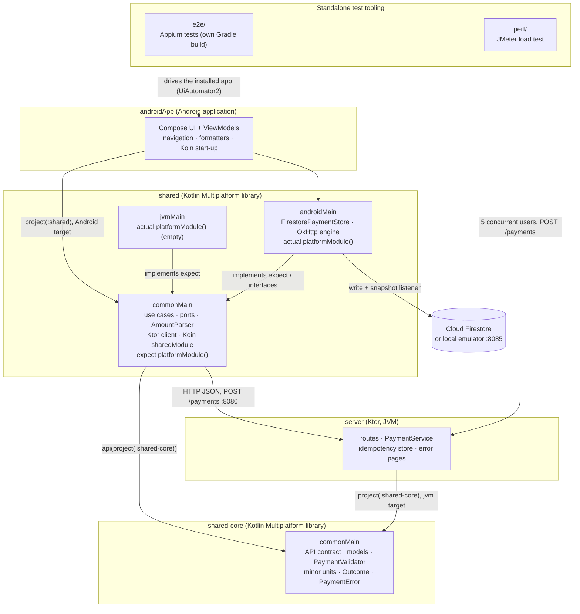

# Project tour

Cashi is a Kotlin Multiplatform payment app: a user sends a payment (recipient email, amount,
currency) and sees a real-time transaction history. Android is the implemented platform; every
piece of business logic (models, validation, money, use cases, the API client) lives in
shared Kotlin Multiplatform code so another platform could reuse it: `shared-core` holds the API
contract and the core domain rules, and `shared` the use cases, the API client and DI. A Ktor
backend in the same repository processes payments and depends only on `shared-core`, so it reuses
the same validator, and payments are stored in Cloud Firestore.

**How to read this document:** start with the [component map](#1-component-map) and the
[directory tree](#2-directory-tree) for orientation, then [follow a payment](#6-follow-a-payment)
through the code. The [file-by-file reference](#3-file-by-file-reference) and the
[test inventory](#4-test-inventory) are for looking things up. Setup and commands are in the
[README](../README.md); the reasons behind the design are in [DESIGN_DECISIONS.md](DESIGN_DECISIONS.md)
(decisions are referenced as D1…), and the architecture in depth is in [ARCHITECTURE.md](ARCHITECTURE.md).

**Contents:** [Component map](#1-component-map) · [Directory tree](#2-directory-tree) ·
[File-by-file reference](#3-file-by-file-reference) · [Test inventory](#4-test-inventory) ·
[Configuration and tooling](#5-configuration-and-tooling) · [Follow a payment](#6-follow-a-payment)

## 1. Component map



- **Solid arrows between modules** are Gradle dependencies; **labelled arrows to the server and
  Firestore** are runtime calls.
- `androidApp` depends on `shared` (its Android target: `commonMain` + `androidMain`), and `shared`
  exposes `shared-core` with `api(...)`. `server` depends only on `shared-core` through its `jvm()`
  target, so nothing from `shared` (its Ktor client setup, Koin, Firebase, Android) reaches the
  server (D50).
- `e2e/` and `perf/` are not part of the app build: they talk to the running app and server from
  the outside.

## 2. Directory tree

Build output and ignored local files (`build/`, `.gradle/`, `local.properties`, the real
`google-services.json`, generated reports) are left out.

```
.
├── README.md                         Setup, run, all test commands, summary of the design
├── build.gradle.kts                  Root build: declares the plugins once (apply false)
├── settings.gradle.kts               Includes :androidApp, :shared, :shared-core, :server; repositories
├── gradle.properties                 Gradle/Kotlin JVM args, configuration cache, AndroidX flags
├── gradlew, gradlew.bat              Gradle wrapper scripts
├── gradle/
│   ├── libs.versions.toml            Version catalog: every library and plugin version
│   ├── gradle-daemon-jvm.properties  JDK the Gradle daemon runs on (21)
│   └── wrapper/                      Wrapper jar and Gradle version
├── firebase.json                     Firestore rules file + emulator ports (8085, UI 4000)
├── .firebaserc                       Default Firebase project for the CLI (rules deploy)
├── firestore.rules                   Security rules: open read, validated create, no update/delete
├── .run/                             Shared IntelliJ/Android Studio run configurations
├── scripts/
│   ├── device-setup.sh               adb reverse 8080 + 8085 for a real device (macOS/Linux)
│   └── device-setup.bat              Same for Windows
├── docs/
│   ├── PROJECT_TOUR.md               This document
│   ├── ARCHITECTURE.md               Modules, layers, flows, expect/actual, error model, iOS potential
│   ├── DESIGN_DECISIONS.md           D1–D50: decisions, reasons, alternatives, limitations
│   ├── API.md                        REST contract: request, responses, errors, idempotency, curl
│   ├── TEST_TAGS.md                  UI test ids (Compose test tags) used by Appium
│   └── DEMO.md                       Demo walkthrough: every feature, step by step
├── shared-core/                      KMP library: API contract and core domain rules (server + clients)
│   ├── build.gradle.kts              Targets android + jvm; kotlinx-serialization only
│   └── src/
│       ├── commonMain/               API contract, models, validator, minor units, Outcome, errors
│       └── commonTest/               Contract, validation, money and model tests
├── shared/                           KMP library: use cases, API client, DI, Firestore (no UI)
│   ├── build.gradle.kts              Targets android + jvm, api(:shared-core), device-test arguments
│   └── src/
│       ├── commonMain/               Use cases, ports, AmountParser, Ktor client, Koin module
│       ├── androidMain/              Firestore store, OkHttp engine, Android platformModule()
│       ├── jvmMain/                  JVM platformModule() (empty; for the JVM tests)
│       ├── commonTest/               Use case, MockEngine and store contract tests + fakes
│       ├── jvmTest/                  Cucumber BDD scenarios, Koin graph test
│       ├── androidHostTest/          Firestore document mapping on the JVM host
│       └── androidDeviceTest/        Firestore store contract on a device against the emulator
├── androidApp/                       Android application (Jetpack Compose)
│   ├── build.gradle.kts              BuildConfig fields from local.properties, Firebase plugin
│   ├── google-services.json.example  Placeholder Firebase config for the emulator-only path
│   ├── proguard-rules.pro            Empty on purpose: minification is off (D48)
│   └── src/
│       ├── main/                     Activity, Application, navigation, theme, screens, ViewModels, res
│       ├── debug/                    Debug-only network security config (cleartext to local hosts)
│       ├── test/                     ViewModel and formatter unit tests (JVM)
│       └── androidTest/              Compose navigation test and device smoke tests
├── server/                           Ktor backend (JVM), port 8080
│   ├── build.gradle.kts              Application plugin (run, installDist), dependencies
│   └── src/
│       ├── main/                     Routes, PaymentService, idempotency, error pages, logging
│       └── test/                     testApplication route tests, service and store tests
├── e2e/                              Appium UI tests: standalone Gradle build
│   ├── README.md                     Prerequisites, run commands, troubleshooting
│   ├── settings.gradle.kts           Own build, reuses the root version catalog
│   ├── build.gradle.kts              JUnit + Appium java-client
│   └── src/test/                     Session helper, device selection, ids, the two tests
└── perf/                             JMeter load test (plain folder)
    ├── README.md                     What it measures, how to run, sample results
    ├── payments-load-test.jmx        Test plan: 5 users × 20 requests, assertions
    ├── run-load-test.sh              Non-GUI run + HTML report (macOS/Linux)
    └── run-load-test.bat             Same for Windows
```

## 3. File-by-file reference

Every production source file, grouped by module and layer. Paths in each heading are relative to
the module's source root; the links go to the files.

### shared-core / commonMain: API contract
`shared-core/src/commonMain/kotlin/cashi/payment/oways/shared/api/` (used by both the client and the server)

| File | What it does | Key types or functions | Related tests |
|---|---|---|---|
| [PaymentRequest.kt](../shared-core/src/commonMain/kotlin/cashi/payment/oways/shared/api/PaymentRequest.kt) | Body of `POST /payments` (`recipientEmail`, `amount`, `currency`), raw so the server can report specific errors | `PaymentRequest` | [PaymentContractSerializationTest](../shared-core/src/commonTest/kotlin/cashi/payment/oways/shared/api/PaymentContractSerializationTest.kt) |
| [PaymentResponse.kt](../shared-core/src/commonMain/kotlin/cashi/payment/oways/shared/api/PaymentResponse.kt) | The processed payment returned with 201 | `PaymentResponse` | [PaymentContractSerializationTest](../shared-core/src/commonTest/kotlin/cashi/payment/oways/shared/api/PaymentContractSerializationTest.kt) |
| [ErrorResponse.kt](../shared-core/src/commonMain/kotlin/cashi/payment/oways/shared/api/ErrorResponse.kt) | The `{code, message}` body of every error | `ErrorResponse` | [ErrorContractTest](../shared-core/src/commonTest/kotlin/cashi/payment/oways/shared/api/ErrorContractTest.kt) |
| [ApiErrorCode.kt](../shared-core/src/commonMain/kotlin/cashi/payment/oways/shared/api/ApiErrorCode.kt) | Stable machine-readable error codes | `ApiErrorCode`, `wireValue`, `fromWireValue()` | [ErrorContractTest](../shared-core/src/commonTest/kotlin/cashi/payment/oways/shared/api/ErrorContractTest.kt) |
| [ApiHeaders.kt](../shared-core/src/commonMain/kotlin/cashi/payment/oways/shared/api/ApiHeaders.kt) | Header names | `IDEMPOTENCY_KEY`, `IDEMPOTENT_REPLAYED` | [IdempotencyRoutesTest](../server/src/test/kotlin/cashi/payment/oways/server/payment/IdempotencyRoutesTest.kt) |
| [ApiJson.kt](../shared-core/src/commonMain/kotlin/cashi/payment/oways/shared/api/ApiJson.kt) | One JSON configuration for both sides (unknown keys ignored) | `ApiJson` | [KtorPaymentApiTest](../shared/src/commonTest/kotlin/cashi/payment/oways/shared/data/remote/KtorPaymentApiTest.kt), [PaymentRoutesTest](../server/src/test/kotlin/cashi/payment/oways/server/payment/PaymentRoutesTest.kt) |
| [StrictJsonDoubleSerializer.kt](../shared-core/src/commonMain/kotlin/cashi/payment/oways/shared/api/StrictJsonDoubleSerializer.kt) | Accepts `amount` only as a JSON number, not `"10.5"` or `null` | `StrictJsonDoubleSerializer` | [StrictJsonDoubleSerializerTest](../shared-core/src/commonTest/kotlin/cashi/payment/oways/shared/api/StrictJsonDoubleSerializerTest.kt) |

### shared-core / commonMain: domain models
`shared-core/src/commonMain/kotlin/cashi/payment/oways/shared/domain/model/`

| File | What it does | Key types or functions | Related tests |
|---|---|---|---|
| [Currency.kt](../shared-core/src/commonMain/kotlin/cashi/payment/oways/shared/domain/model/Currency.kt) | Supported currencies with their ISO code and number of decimals | `Currency` (`USD`, `EUR`), `code`, `fractionDigits`, `fromCode()` | [CurrencyTest](../shared-core/src/commonTest/kotlin/cashi/payment/oways/shared/domain/model/CurrencyTest.kt) |
| [PaymentDraft.kt](../shared-core/src/commonMain/kotlin/cashi/payment/oways/shared/domain/model/PaymentDraft.kt) | Unvalidated input from the form or the API | `PaymentDraft` | [PaymentValidatorTest](../shared-core/src/commonTest/kotlin/cashi/payment/oways/shared/domain/validation/PaymentValidatorTest.kt) |
| [ValidatedPayment.kt](../shared-core/src/commonMain/kotlin/cashi/payment/oways/shared/domain/model/ValidatedPayment.kt) | Input that passed the validator; internal constructor and `copy()`, so holding one proves it was checked | `ValidatedPayment` | [PaymentValidatorTest](../shared-core/src/commonTest/kotlin/cashi/payment/oways/shared/domain/validation/PaymentValidatorTest.kt) |
| [Payment.kt](../shared-core/src/commonMain/kotlin/cashi/payment/oways/shared/domain/model/Payment.kt) | A payment the backend processed, amount in minor units | `Payment` | [PaymentApiMappersTest](../shared/src/commonTest/kotlin/cashi/payment/oways/shared/data/remote/PaymentApiMappersTest.kt) |
| [IdempotencyKey.kt](../shared-core/src/commonMain/kotlin/cashi/payment/oways/shared/domain/model/IdempotencyKey.kt) | Opaque key that makes a submission safe to retry; one definition for client and server | `IdempotencyKey`, `parse()`, `random()` | [IdempotencyKeyTest](../shared-core/src/commonTest/kotlin/cashi/payment/oways/shared/domain/model/IdempotencyKeyTest.kt) |

### shared-core / commonMain: validation, money, results, errors
`shared-core/src/commonMain/kotlin/cashi/payment/oways/shared/domain/`

| File | What it does | Key types or functions | Related tests |
|---|---|---|---|
| [money/MinorUnits.kt](../shared-core/src/commonMain/kotlin/cashi/payment/oways/shared/domain/money/MinorUnits.kt) | Exact `Double` ↔ `Long` minor-unit conversion with the 1,000,000.00 business limit | `toMinorUnits()`, `toMajorUnits()`, `MAX_AMOUNT_MINOR` | [MinorUnitsTest](../shared-core/src/commonTest/kotlin/cashi/payment/oways/shared/domain/money/MinorUnitsTest.kt) |
| [validation/PaymentValidator.kt](../shared-core/src/commonMain/kotlin/cashi/payment/oways/shared/domain/validation/PaymentValidator.kt) | The one validator for app and server: email → currency → amount, first failure wins | `PaymentValidator.validate()` | [PaymentValidatorTest](../shared-core/src/commonTest/kotlin/cashi/payment/oways/shared/domain/validation/PaymentValidatorTest.kt) |
| [result/Outcome.kt](../shared-core/src/commonMain/kotlin/cashi/payment/oways/shared/domain/result/Outcome.kt) | Success-or-typed-failure result with exhaustive matching | `Outcome` (`Success`, `Failure`), `map`, `flatMap` | [OutcomeTest](../shared-core/src/commonTest/kotlin/cashi/payment/oways/shared/domain/result/OutcomeTest.kt) |
| [error/PaymentError.kt](../shared-core/src/commonMain/kotlin/cashi/payment/oways/shared/domain/error/PaymentError.kt) | Every way sending can fail | `PaymentError` (`Validation`: `InvalidEmail`, `InvalidAmount`, `UnsupportedCurrency`; `Network`; `Server`) | [PaymentValidatorTest](../shared-core/src/commonTest/kotlin/cashi/payment/oways/shared/domain/validation/PaymentValidatorTest.kt), [KtorPaymentApiErrorTest](../shared/src/commonTest/kotlin/cashi/payment/oways/shared/data/remote/KtorPaymentApiErrorTest.kt) |

### shared / commonMain: history models
`shared/src/commonMain/kotlin/cashi/payment/oways/shared/domain/model/`

| File | What it does | Key types or functions | Related tests |
|---|---|---|---|
| [SentPayment.kt](../shared/src/commonMain/kotlin/cashi/payment/oways/shared/domain/model/SentPayment.kt) | Result of a send: the payment plus whether it reached the history | `SentPayment`, `HistoryStatus` (`Recorded`, `NotRecorded`) | [SendPaymentUseCaseTest](../shared/src/commonTest/kotlin/cashi/payment/oways/shared/domain/usecase/SendPaymentUseCaseTest.kt) |
| [PaymentOrdering.kt](../shared/src/commonMain/kotlin/cashi/payment/oways/shared/domain/model/PaymentOrdering.kt) | The canonical history order: newest first, ties broken by id | `PaymentOrdering` | [PaymentStoreContractTest](../shared/src/commonTest/kotlin/cashi/payment/oways/shared/domain/gateway/PaymentStoreContractTest.kt) |

### shared / commonMain: amount parsing and store errors
`shared/src/commonMain/kotlin/cashi/payment/oways/shared/domain/`

| File | What it does | Key types or functions | Related tests |
|---|---|---|---|
| [validation/AmountParser.kt](../shared/src/commonMain/kotlin/cashi/payment/oways/shared/domain/validation/AmountParser.kt) | Parses the typed amount (`.` or `,` decimals), counting fraction digits in the text | `AmountParser.parse()` | [AmountParserTest](../shared/src/commonTest/kotlin/cashi/payment/oways/shared/domain/validation/AmountParserTest.kt) |
| [error/PaymentStoreError.kt](../shared/src/commonMain/kotlin/cashi/payment/oways/shared/domain/error/PaymentStoreError.kt) | History-store failures, separate from payment failures | `PaymentStoreError` (`Unavailable`, `PermissionDenied`, `Conflict`), `PaymentStoreException` | [PaymentStoreContractTest](../shared/src/commonTest/kotlin/cashi/payment/oways/shared/domain/gateway/PaymentStoreContractTest.kt) |

### shared / commonMain: ports and use cases
`shared/src/commonMain/kotlin/cashi/payment/oways/shared/domain/`

| File | What it does | Key types or functions | Related tests |
|---|---|---|---|
| [gateway/PaymentApi.kt](../shared/src/commonMain/kotlin/cashi/payment/oways/shared/domain/gateway/PaymentApi.kt) | Interface to the backend; takes only validated input | `PaymentApi.createPayment()` | [KtorPaymentApiTest](../shared/src/commonTest/kotlin/cashi/payment/oways/shared/data/remote/KtorPaymentApiTest.kt), [FakePaymentApi](../shared/src/commonTest/kotlin/cashi/payment/oways/shared/testing/FakePaymentApi.kt) |
| [gateway/PaymentStore.kt](../shared/src/commonMain/kotlin/cashi/payment/oways/shared/domain/gateway/PaymentStore.kt) | Interface to the transaction history; the store assigns the timestamp | `PaymentStore.save()`, `observePayments()` | [PaymentStoreContractTest](../shared/src/commonTest/kotlin/cashi/payment/oways/shared/domain/gateway/PaymentStoreContractTest.kt) |
| [usecase/SendPaymentUseCase.kt](../shared/src/commonMain/kotlin/cashi/payment/oways/shared/domain/usecase/SendPaymentUseCase.kt) | Validate locally → backend → record in history; a history failure never reads as "payment failed" | `SendPaymentUseCase.invoke(draft, idempotencyKey)` | [SendPaymentUseCaseTest](../shared/src/commonTest/kotlin/cashi/payment/oways/shared/domain/usecase/SendPaymentUseCaseTest.kt), [payment_creation.feature](../shared/src/jvmTest/resources/features/payment_creation.feature) |
| [usecase/ObservePaymentsUseCase.kt](../shared/src/commonMain/kotlin/cashi/payment/oways/shared/domain/usecase/ObservePaymentsUseCase.kt) | Live history, newest first, without repeated equal lists | `ObservePaymentsUseCase.invoke(): Flow<List<Payment>>` | [ObservePaymentsUseCaseTest](../shared/src/commonTest/kotlin/cashi/payment/oways/shared/domain/usecase/ObservePaymentsUseCaseTest.kt), [transaction_listing.feature](../shared/src/jvmTest/resources/features/transaction_listing.feature) |

### shared / commonMain: HTTP client
`shared/src/commonMain/kotlin/cashi/payment/oways/shared/data/remote/`

| File | What it does | Key types or functions | Related tests |
|---|---|---|---|
| [PaymentHttpClient.kt](../shared/src/commonMain/kotlin/cashi/payment/oways/shared/data/remote/PaymentHttpClient.kt) | Builds the Ktor client: base URL, JSON, timeouts, no logging of bodies | `createPaymentHttpClient()`, `PaymentHttpTimeouts` | [KtorPaymentApiErrorTest](../shared/src/commonTest/kotlin/cashi/payment/oways/shared/data/remote/KtorPaymentApiErrorTest.kt) |
| [KtorPaymentApi.kt](../shared/src/commonMain/kotlin/cashi/payment/oways/shared/data/remote/KtorPaymentApi.kt) | `PaymentApi` over HTTP; I/O failures become `PaymentError.Network` | `KtorPaymentApi.createPayment()` | [KtorPaymentApiTest](../shared/src/commonTest/kotlin/cashi/payment/oways/shared/data/remote/KtorPaymentApiTest.kt), [KtorPaymentApiErrorTest](../shared/src/commonTest/kotlin/cashi/payment/oways/shared/data/remote/KtorPaymentApiErrorTest.kt) |
| [PaymentApiMappers.kt](../shared/src/commonMain/kotlin/cashi/payment/oways/shared/data/remote/PaymentApiMappers.kt) | Domain ↔ wire mapping; a response that breaks the contract maps to `null` | `toRequest()`, `toDomain()` | [PaymentApiMappersTest](../shared/src/commonTest/kotlin/cashi/payment/oways/shared/data/remote/PaymentApiMappersTest.kt) |
| [PaymentErrorMapping.kt](../shared/src/commonMain/kotlin/cashi/payment/oways/shared/data/remote/PaymentErrorMapping.kt) | API error code → domain error (validation codes → the validator's errors) | `toPaymentError()` | [KtorPaymentApiErrorTest](../shared/src/commonTest/kotlin/cashi/payment/oways/shared/data/remote/KtorPaymentApiErrorTest.kt) |

### shared / commonMain: dependency injection
`shared/src/commonMain/kotlin/cashi/payment/oways/shared/di/`

| File | What it does | Key types or functions | Related tests |
|---|---|---|---|
| [SharedModule.kt](../shared/src/commonMain/kotlin/cashi/payment/oways/shared/di/SharedModule.kt) | Koin graph of the shared code: validator, HTTP client, API, use cases | `sharedModule()`, `PaymentConfig` | [SharedModuleTest](../shared/src/jvmTest/kotlin/cashi/payment/oways/shared/di/SharedModuleTest.kt) |
| [PlatformModule.kt](../shared/src/commonMain/kotlin/cashi/payment/oways/shared/di/PlatformModule.kt) | The `expect` declaration: each platform supplies its HTTP engine and `PaymentStore` | `expect fun platformModule()` | [SharedModuleTest](../shared/src/jvmTest/kotlin/cashi/payment/oways/shared/di/SharedModuleTest.kt) |
| [FirestoreEmulatorConfig.kt](../shared/src/commonMain/kotlin/cashi/payment/oways/shared/di/FirestoreEmulatorConfig.kt) | Host and port of a local Firestore emulator | `FirestoreEmulatorConfig` | [FirestoreEmulatorConnectivityTest](../androidApp/src/androidTest/kotlin/cashi/payment/oways/FirestoreEmulatorConnectivityTest.kt) |

### shared / androidMain: Firestore, OkHttp, Android DI
`shared/src/androidMain/kotlin/cashi/payment/oways/shared/`

| File | What it does | Key types or functions | Related tests |
|---|---|---|---|
| [data/firestore/FirestorePaymentStore.kt](../shared/src/androidMain/kotlin/cashi/payment/oways/shared/data/firestore/FirestorePaymentStore.kt) | `PaymentStore` on Firestore `payments/{paymentId}`: write-once save with a 10 s timeout, live history via `callbackFlow` | `FirestorePaymentStore.save()`, `observePayments()` | [FirestorePaymentStoreContractTest](../shared/src/androidDeviceTest/kotlin/cashi/payment/oways/shared/data/firestore/FirestorePaymentStoreContractTest.kt) |
| [data/firestore/PaymentDocument.kt](../shared/src/androidMain/kotlin/cashi/payment/oways/shared/data/firestore/PaymentDocument.kt) | Document layout matching `firestore.rules`; server timestamp; skips malformed documents | `toDocumentData()`, `paymentFromDocument()`, `hasSameContentAs()` | [PaymentDocumentTest](../shared/src/androidHostTest/kotlin/cashi/payment/oways/shared/data/firestore/PaymentDocumentTest.kt) |
| [data/firestore/FirestoreErrorMapping.kt](../shared/src/androidMain/kotlin/cashi/payment/oways/shared/data/firestore/FirestoreErrorMapping.kt) | Firestore error code → `PaymentStoreError` | `toStoreError()` | [FirestorePaymentStoreContractTest](../shared/src/androidDeviceTest/kotlin/cashi/payment/oways/shared/data/firestore/FirestorePaymentStoreContractTest.kt) |
| [data/firestore/PaymentFirestoreFactory.kt](../shared/src/androidMain/kotlin/cashi/payment/oways/shared/data/firestore/PaymentFirestoreFactory.kt) | Creates the store on the default FirebaseApp, optionally pointed at the emulator | `createFirestorePaymentStore()` | [FirestoreEmulatorConnectivityTest](../androidApp/src/androidTest/kotlin/cashi/payment/oways/FirestoreEmulatorConnectivityTest.kt) |
| [data/remote/OkHttpEngineFactory.kt](../shared/src/androidMain/kotlin/cashi/payment/oways/shared/data/remote/OkHttpEngineFactory.kt) | The Android HTTP engine | `createOkHttpEngine()` | [ApiConnectivityTest](../androidApp/src/androidTest/kotlin/cashi/payment/oways/ApiConnectivityTest.kt) |
| [di/PlatformModule.android.kt](../shared/src/androidMain/kotlin/cashi/payment/oways/shared/di/PlatformModule.android.kt) | `actual` module: OkHttp engine and the Firestore store (single) | `actual fun platformModule()` | [FirestoreEmulatorConnectivityTest](../androidApp/src/androidTest/kotlin/cashi/payment/oways/FirestoreEmulatorConnectivityTest.kt) |

### shared / jvmMain
| File | What it does | Key types or functions | Related tests |
|---|---|---|---|
| [di/PlatformModule.jvm.kt](../shared/src/jvmMain/kotlin/cashi/payment/oways/shared/di/PlatformModule.jvm.kt) | Empty `actual` module: the JVM target only runs the Cucumber and Koin graph tests (the server uses `shared-core`) | `actual fun platformModule()` | [SharedModuleTest](../shared/src/jvmTest/kotlin/cashi/payment/oways/shared/di/SharedModuleTest.kt) |

### androidApp: application, DI and navigation
`androidApp/src/main/kotlin/cashi/payment/oways/`

| File | What it does | Key types or functions | Related tests |
|---|---|---|---|
| [CashiApplication.kt](../androidApp/src/main/kotlin/cashi/payment/oways/CashiApplication.kt) | Starts Koin; the only place `BuildConfig` values enter the graph | `CashiApplication`, `appConfigModule` | [ApiConnectivityTest](../androidApp/src/androidTest/kotlin/cashi/payment/oways/ApiConnectivityTest.kt) |
| [MainActivity.kt](../androidApp/src/main/kotlin/cashi/payment/oways/MainActivity.kt) | Single activity hosting the Compose app | `MainActivity` | [NavigationTest](../androidApp/src/androidTest/kotlin/cashi/payment/oways/navigation/NavigationTest.kt) |
| [CashiApp.kt](../androidApp/src/main/kotlin/cashi/payment/oways/CashiApp.kt) | App root: Scaffold, bottom navigation, the shared snackbar host, test tags as resource ids | `CashiApp()` | [NavigationTest](../androidApp/src/androidTest/kotlin/cashi/payment/oways/navigation/NavigationTest.kt) |
| [di/ViewModelModule.kt](../androidApp/src/main/kotlin/cashi/payment/oways/di/ViewModelModule.kt) | Koin module for the ViewModels and formatters | `viewModelModule` | [SendPaymentViewModelTest](../androidApp/src/test/kotlin/cashi/payment/oways/ui/send/SendPaymentViewModelTest.kt) |
| [navigation/AppRoutes.kt](../androidApp/src/main/kotlin/cashi/payment/oways/navigation/AppRoutes.kt) | Type-safe routes | `SendRoute`, `HistoryRoute` | [NavigationTest](../androidApp/src/androidTest/kotlin/cashi/payment/oways/navigation/NavigationTest.kt) |
| [navigation/TopLevelDestination.kt](../androidApp/src/main/kotlin/cashi/payment/oways/navigation/TopLevelDestination.kt) | The bottom-bar tabs, with label, icon and test tag | `TopLevelDestination` | [NavigationTest](../androidApp/src/androidTest/kotlin/cashi/payment/oways/navigation/NavigationTest.kt) |
| [navigation/CashiNavHost.kt](../androidApp/src/main/kotlin/cashi/payment/oways/navigation/CashiNavHost.kt) | NavHost and tab switching without back-stack growth | `CashiNavHost()`, `navigateToTopLevel()` | [NavigationTest](../androidApp/src/androidTest/kotlin/cashi/payment/oways/navigation/NavigationTest.kt) |

### androidApp: UI
`androidApp/src/main/kotlin/cashi/payment/oways/ui/`

| File | What it does | Key types or functions | Related tests |
|---|---|---|---|
| [send/SendScreen.kt](../androidApp/src/main/kotlin/cashi/payment/oways/ui/send/SendScreen.kt) | Send form in two cards (recipient; amount with the currency dropdown), Send button, confirmation dialog, snackbar; stateless content + ViewModel wrapper | `SendScreen()`, `SendPaymentContent()`, `SendPaymentActions` | [SendPaymentE2ETest](../e2e/src/test/kotlin/cashi/payment/oways/e2e/SendPaymentE2ETest.kt) |
| [send/SendPaymentUiState.kt](../androidApp/src/main/kotlin/cashi/payment/oways/ui/send/SendPaymentUiState.kt) | The single Send screen state | `SendPaymentUiState`, `FieldError`, `PaymentConfirmation`, `SubmissionStatus` | [SendPaymentViewModelTest](../androidApp/src/test/kotlin/cashi/payment/oways/ui/send/SendPaymentViewModelTest.kt) |
| [send/SendPaymentViewModel.kt](../androidApp/src/main/kotlin/cashi/payment/oways/ui/send/SendPaymentViewModel.kt) | Holds the form, asks for confirmation, calls the use case, reuses the idempotency key for an unchanged retry | `onSendClick()`, `onConfirm()`, `onStatusShown()` | [SendPaymentViewModelTest](../androidApp/src/test/kotlin/cashi/payment/oways/ui/send/SendPaymentViewModelTest.kt) |
| [history/HistoryScreen.kt](../androidApp/src/main/kotlin/cashi/payment/oways/ui/history/HistoryScreen.kt) | History as cards (recipient initial, recipient, timestamp, amount with currency code), with loading, empty and error states | `HistoryScreen()`, `HistoryContent()` | [SendPaymentE2ETest](../e2e/src/test/kotlin/cashi/payment/oways/e2e/SendPaymentE2ETest.kt) |
| [history/HistoryUiState.kt](../androidApp/src/main/kotlin/cashi/payment/oways/ui/history/HistoryUiState.kt) | The single History screen state | `HistoryUiState` (`Loading`, `Empty`, `Content`, `Error`), `PaymentItem` | [HistoryViewModelTest](../androidApp/src/test/kotlin/cashi/payment/oways/ui/history/HistoryViewModelTest.kt) |
| [history/HistoryViewModel.kt](../androidApp/src/main/kotlin/cashi/payment/oways/ui/history/HistoryViewModel.kt) | Maps the live history to UI rows; listens only while the screen is visible (+5 s) | `HistoryViewModel.state`, `onRetry()` | [HistoryViewModelTest](../androidApp/src/test/kotlin/cashi/payment/oways/ui/history/HistoryViewModelTest.kt) |
| [format/AmountFormatter.kt](../androidApp/src/main/kotlin/cashi/payment/oways/ui/format/AmountFormatter.kt) | Minor units → locale currency text, e.g. "$10.50" | `AmountFormatter.format()` | [AmountFormatterTest](../androidApp/src/test/kotlin/cashi/payment/oways/ui/format/AmountFormatterTest.kt) |
| [format/TimestampFormatter.kt](../androidApp/src/main/kotlin/cashi/payment/oways/ui/format/TimestampFormatter.kt) | Timestamp → medium date + short time (no `java.time`, minSdk 24) | `TimestampFormatter.format()` | [TimestampFormatterTest](../androidApp/src/test/kotlin/cashi/payment/oways/ui/format/TimestampFormatterTest.kt) |
| [AppTestTags.kt](../androidApp/src/main/kotlin/cashi/payment/oways/ui/AppTestTags.kt) | Stable test tags, which are also the Appium resource ids ([TEST_TAGS.md](TEST_TAGS.md)) | `AppTestTags` | [NavigationTest](../androidApp/src/androidTest/kotlin/cashi/payment/oways/navigation/NavigationTest.kt), [TestIds](../e2e/src/test/kotlin/cashi/payment/oways/e2e/TestIds.kt) |
| [TestTagsAsResourceIds.kt](../androidApp/src/main/kotlin/cashi/payment/oways/ui/TestTagsAsResourceIds.kt) | Exposes test tags as resource ids (applied at the root and in each dialog/popup window) | `Modifier.testTagsAsResourceIds()` | [SendPaymentE2ETest](../e2e/src/test/kotlin/cashi/payment/oways/e2e/SendPaymentE2ETest.kt) |

### androidApp: theme
`androidApp/src/main/kotlin/cashi/payment/oways/ui/theme/`

| File | What it does | Key types or functions | Related tests |
|---|---|---|---|
| [Theme.kt](../androidApp/src/main/kotlin/cashi/payment/oways/ui/theme/Theme.kt) | The app theme: fixed brand colors in light and dark mode (no dynamic color, D49), type scale and shapes | `CashiTheme()` | [NavigationTest](../androidApp/src/androidTest/kotlin/cashi/payment/oways/navigation/NavigationTest.kt) |
| [Color.kt](../androidApp/src/main/kotlin/cashi/payment/oways/ui/theme/Color.kt) | Emerald-teal palette as Material 3 tonal roles (every text pair meets WCAG AA contrast) | `LightColors`, `DarkColors` | — |
| [Type.kt](../androidApp/src/main/kotlin/cashi/payment/oways/ui/theme/Type.kt) | Material 3 type scale on the system font; amount styles with tabular figures | `CashiTypography`, `Typography.amountInput`, `Typography.amountRow` | — |
| [Shape.kt](../androidApp/src/main/kotlin/cashi/payment/oways/ui/theme/Shape.kt) | Corner radii: 8dp menus, 16dp cards, fields and buttons, 24dp dialogs | `CashiShapes` | — |

### androidApp: resources and manifest
| File | What it does |
|---|---|
| [AndroidManifest.xml](../androidApp/src/main/AndroidManifest.xml) | Application class, window theme, launcher activity, `INTERNET` permission, network security config |
| [res/values/themes.xml](../androidApp/src/main/res/values/themes.xml), [res/values-night/themes.xml](../androidApp/src/main/res/values-night/themes.xml) | Window theme behind Compose with the brand background, so launch shows no off-color flash in light or dark mode |
| [res/values/strings.xml](../androidApp/src/main/res/values/strings.xml) | Every user-facing text, including "Payment sent" and the error messages |
| [res/values/dimens.xml](../androidApp/src/main/res/values/dimens.xml) | Shared spacing and size values |
| [res/drawable/ic_pay.xml](../androidApp/src/main/res/drawable/ic_pay.xml), [ic_history.xml](../androidApp/src/main/res/drawable/ic_history.xml) | Bottom-bar icons (`ic_pay` also on the Send button and in the confirmation dialog) |
| [res/drawable/ic_mail.xml](../androidApp/src/main/res/drawable/ic_mail.xml), [ic_receipt.xml](../androidApp/src/main/res/drawable/ic_receipt.xml), [ic_error.xml](../androidApp/src/main/res/drawable/ic_error.xml) | Email field icon; History empty and error state icons |
| [res/drawable/ic_launcher_background.xml](../androidApp/src/main/res/drawable/ic_launcher_background.xml), [res/drawable/ic_launcher_foreground.xml](../androidApp/src/main/res/drawable/ic_launcher_foreground.xml) | Launcher icon layers: teal background and the white coin with a send arrow (also the monochrome layer for themed icons) |
| [res/mipmap-anydpi-v26/](../androidApp/src/main/res/mipmap-anydpi-v26/) | Adaptive launcher icon (API 26+), square and round, with a monochrome layer |
| [res/mipmap/](../androidApp/src/main/res/mipmap/) | Launcher icon for API 24–25: the same vectors in a rounded square or circle |

### server: application and configuration
`server/src/main/kotlin/cashi/payment/oways/server/`

| File | What it does | Key types or functions | Related tests |
|---|---|---|---|
| [Application.kt](../server/src/main/kotlin/cashi/payment/oways/server/Application.kt) | Entry point (Netty) and composition of plugins and routes; dependencies passed in for tests | `main()`, `Application.module(paymentService)` | [PaymentRoutesTest](../server/src/test/kotlin/cashi/payment/oways/server/payment/PaymentRoutesTest.kt) |
| [config/ServerConfig.kt](../server/src/main/kotlin/cashi/payment/oways/server/config/ServerConfig.kt) | Host and port from `SERVER_HOST` / `SERVER_PORT`, default `127.0.0.1:8080` | `ServerConfig` | [HealthRoutesTest](../server/src/test/kotlin/cashi/payment/oways/server/health/HealthRoutesTest.kt) |
| [health/HealthRoutes.kt](../server/src/main/kotlin/cashi/payment/oways/server/health/HealthRoutes.kt) | `GET /health` → `{"status":"UP"}` | `healthRoutes()`, `HealthResponse` | [HealthRoutesTest](../server/src/test/kotlin/cashi/payment/oways/server/health/HealthRoutesTest.kt) |

### server: payments
`server/src/main/kotlin/cashi/payment/oways/server/payment/`

| File | What it does | Key types or functions | Related tests |
|---|---|---|---|
| [PaymentRoutes.kt](../server/src/main/kotlin/cashi/payment/oways/server/payment/PaymentRoutes.kt) | `POST /payments`: reads the optional `Idempotency-Key`, responds 201 (with `Idempotent-Replayed` on replays), 400 or 422 | `paymentRoutes()` | [PaymentRoutesTest](../server/src/test/kotlin/cashi/payment/oways/server/payment/PaymentRoutesTest.kt), [IdempotencyRoutesTest](../server/src/test/kotlin/cashi/payment/oways/server/payment/IdempotencyRoutesTest.kt) |
| [PaymentService.kt](../server/src/main/kotlin/cashi/payment/oways/server/payment/PaymentService.kt) | Validates with the shared validator, creates the payment, deduplicates by key | `PaymentService.process()`, `ProcessedPayment`, `ProcessPaymentFailure` | [PaymentServiceTest](../server/src/test/kotlin/cashi/payment/oways/server/payment/PaymentServiceTest.kt) |
| [PaymentMappers.kt](../server/src/main/kotlin/cashi/payment/oways/server/payment/PaymentMappers.kt) | Wire ↔ domain mapping on the server side | `PaymentRequest.toDraft()`, `Payment.toResponse()` | [PaymentRoutesTest](../server/src/test/kotlin/cashi/payment/oways/server/payment/PaymentRoutesTest.kt) |
| [PaymentIdGenerator.kt](../server/src/main/kotlin/cashi/payment/oways/server/payment/PaymentIdGenerator.kt) | Unique payment ids, injectable for fixed ids in tests | `PaymentIdGenerator` | [TestFixtures](../server/src/test/kotlin/cashi/payment/oways/server/payment/TestFixtures.kt) |

### server: idempotency, errors and plugins
`server/src/main/kotlin/cashi/payment/oways/server/`

| File | What it does | Key types or functions | Related tests |
|---|---|---|---|
| [idempotency/IdempotencyStore.kt](../server/src/main/kotlin/cashi/payment/oways/server/idempotency/IdempotencyStore.kt) | Interface: atomic check-and-create per key | `IdempotencyStore.getOrCreate()`, `IdempotencyResult` | [InMemoryIdempotencyStoreTest](../server/src/test/kotlin/cashi/payment/oways/server/idempotency/InMemoryIdempotencyStoreTest.kt) |
| [idempotency/InMemoryIdempotencyStore.kt](../server/src/main/kotlin/cashi/payment/oways/server/idempotency/InMemoryIdempotencyStore.kt) | Single-instance store: one lock, 24 h TTL, 10,000-entry LRU | `InMemoryIdempotencyStore` | [InMemoryIdempotencyStoreTest](../server/src/test/kotlin/cashi/payment/oways/server/idempotency/InMemoryIdempotencyStoreTest.kt) |
| [error/ErrorResponses.kt](../server/src/main/kotlin/cashi/payment/oways/server/error/ErrorResponses.kt) | Error messages and the exhaustive validation-error → API-code mapping | `errorResponse()`, `PaymentError.Validation.toErrorResponse()` | [PaymentRoutesTest](../server/src/test/kotlin/cashi/payment/oways/server/payment/PaymentRoutesTest.kt) |
| [plugins/StatusPages.kt](../server/src/main/kotlin/cashi/payment/oways/server/plugins/StatusPages.kt) | Same `{code, message}` body for 400, 404, 405, 415 and 500 | `configureStatusPages()` | [StatusPagesTest](../server/src/test/kotlin/cashi/payment/oways/server/plugins/StatusPagesTest.kt) |
| [plugins/Serialization.kt](../server/src/main/kotlin/cashi/payment/oways/server/plugins/Serialization.kt) | Content negotiation with the shared `ApiJson` | `configureSerialization()` | [PaymentRoutesTest](../server/src/test/kotlin/cashi/payment/oways/server/payment/PaymentRoutesTest.kt) |
| [plugins/Monitoring.kt](../server/src/main/kotlin/cashi/payment/oways/server/plugins/Monitoring.kt) | Request log with method, path, status and duration only (bodies contain emails) | `configureMonitoring()` | — |
| [`src/main/resources/logback.xml`](../server/src/main/resources/logback.xml) | Log format and levels | — | — |

## 4. Test inventory

Run commands from the repository root. "No device" tests are also part of `./gradlew build`.

| Module | Test file | Type | What it verifies | How to run |
|---|---|---|---|---|
| shared-core | [CurrencyTest](../shared-core/src/commonTest/kotlin/cashi/payment/oways/shared/domain/model/CurrencyTest.kt) | Unit | Codes and decimals of USD/EUR; unknown or malformed codes return `null` | `./gradlew :shared-core:allTests` (no device) |
| shared-core | [IdempotencyKeyTest](../shared-core/src/commonTest/kotlin/cashi/payment/oways/shared/domain/model/IdempotencyKeyTest.kt) | Unit | Valid and invalid keys; random keys are distinct and valid | `:shared-core:allTests` |
| shared-core | [MinorUnitsTest](../shared-core/src/commonTest/kotlin/cashi/payment/oways/shared/domain/money/MinorUnitsTest.kt) | Unit | Exact conversion, too many decimals, non-finite values, the business limit, round trip | `:shared-core:allTests` |
| shared-core | [OutcomeTest](../shared-core/src/commonTest/kotlin/cashi/payment/oways/shared/domain/result/OutcomeTest.kt) | Unit | `map` and `flatMap` on success and failure | `:shared-core:allTests` |
| shared-core | [PaymentValidatorTest](../shared-core/src/commonTest/kotlin/cashi/payment/oways/shared/domain/validation/PaymentValidatorTest.kt) | Unit | Valid and invalid emails, amounts and currencies; trimming; first failing rule wins | `:shared-core:allTests` |
| shared-core | [PaymentContractSerializationTest](../shared-core/src/commonTest/kotlin/cashi/payment/oways/shared/api/PaymentContractSerializationTest.kt) | Unit | Request JSON matches the brief's contract; missing fields fail; response decodes | `:shared-core:allTests` |
| shared-core | [StrictJsonDoubleSerializerTest](../shared-core/src/commonTest/kotlin/cashi/payment/oways/shared/api/StrictJsonDoubleSerializerTest.kt) | Unit | Numbers accepted; quoted numbers and `null` rejected | `:shared-core:allTests` |
| shared-core | [ErrorContractTest](../shared-core/src/commonTest/kotlin/cashi/payment/oways/shared/api/ErrorContractTest.kt) | Unit | Error codes round-trip; unknown codes decode; error body shape | `:shared-core:allTests` |
| shared | [AmountParserTest](../shared/src/commonTest/kotlin/cashi/payment/oways/shared/domain/validation/AmountParserTest.kt) | Unit | Dot or comma decimals; `1,500` rejected (digits counted in the text); malformed input | `./gradlew :shared:allTests` (no device) |
| shared | [SendPaymentUseCaseTest](../shared/src/commonTest/kotlin/cashi/payment/oways/shared/domain/usecase/SendPaymentUseCaseTest.kt) | Unit (fakes) | Invalid input never calls API or store; success records; API failure records nothing; store failure is still "sent"; retry sends the same key | `:shared:allTests` |
| shared | [ObservePaymentsUseCaseTest](../shared/src/commonTest/kotlin/cashi/payment/oways/shared/domain/usecase/ObservePaymentsUseCaseTest.kt) | Unit (fakes) | Empty history first, live updates newest first, duplicates dropped, typed failure | `:shared:allTests` |
| shared | [PaymentStoreContractTest](../shared/src/commonTest/kotlin/cashi/payment/oways/shared/domain/gateway/PaymentStoreContractTest.kt) | Contract (abstract) | What every `PaymentStore` must do: ordering, idempotent save, conflict on different data, store-assigned timestamp | Runs through its two subclasses below |
| shared | [InMemoryPaymentStoreTest](../shared/src/commonTest/kotlin/cashi/payment/oways/shared/testing/InMemoryPaymentStoreTest.kt) | Contract | The contract on the in-memory fake, plus its failure switches | `:shared:allTests` |
| shared | [PaymentApiMappersTest](../shared/src/commonTest/kotlin/cashi/payment/oways/shared/data/remote/PaymentApiMappersTest.kt) | Unit | Minor → major amount in requests; valid and contract-violating responses | `:shared:allTests` |
| shared | [KtorPaymentApiTest](../shared/src/commonTest/kotlin/cashi/payment/oways/shared/data/remote/KtorPaymentApiTest.kt) | MockEngine | Request body and `Idempotency-Key` header; 201 parsing; unknown fields; contract violations | `:shared:allTests` |
| shared | [KtorPaymentApiErrorTest](../shared/src/commonTest/kotlin/cashi/payment/oways/shared/data/remote/KtorPaymentApiErrorTest.kt) | MockEngine | 400 codes → validation errors; other codes, bad bodies → server error; I/O and timeout → network; cancellation rethrown | `:shared:allTests` |
| shared | [FakePaymentApi](../shared/src/commonTest/kotlin/cashi/payment/oways/shared/testing/FakePaymentApi.kt), [InMemoryPaymentStore](../shared/src/commonTest/kotlin/cashi/payment/oways/shared/testing/InMemoryPaymentStore.kt), [ValidatedPayments](../shared/src/commonTest/kotlin/cashi/payment/oways/shared/testing/ValidatedPayments.kt) | Test doubles | Fakes used by the use-case tests and the Cucumber steps; `validatedPayment()` through the validator (its constructor is internal to `shared-core`) | — |
| shared | [SharedModuleTest](../shared/src/jvmTest/kotlin/cashi/payment/oways/shared/di/SharedModuleTest.kt) | Unit (Koin) | The real shared graph resolves; the resolved use case calls the configured backend with a key; singletons | `./gradlew :shared:jvmTest` (no device) |
| shared | [RunCucumberTest](../shared/src/jvmTest/kotlin/cashi/payment/oways/shared/bdd/RunCucumberTest.kt), [PaymentSteps](../shared/src/jvmTest/kotlin/cashi/payment/oways/shared/bdd/PaymentSteps.kt), [payment_creation.feature](../shared/src/jvmTest/resources/features/payment_creation.feature), [transaction_listing.feature](../shared/src/jvmTest/resources/features/transaction_listing.feature), [junit-platform.properties](../shared/src/jvmTest/resources/junit-platform.properties) | Cucumber | 3 scenarios on the real use cases: valid payment, invalid recipient, history newest first in real time | `./gradlew :shared:jvmTest`; report at `shared/build/reports/cucumber/cucumber.html` |
| shared | [PaymentDocumentTest](../shared/src/androidHostTest/kotlin/cashi/payment/oways/shared/data/firestore/PaymentDocumentTest.kt) | Unit (Android host) | Document fields exactly match the rules; Firestore timestamp is used; malformed documents skipped | `./gradlew :shared:testAndroidHostTest` (part of `allTests`) |
| shared | [FirestorePaymentStoreContractTest](../shared/src/androidDeviceTest/kotlin/cashi/payment/oways/shared/data/firestore/FirestorePaymentStoreContractTest.kt), [FirestoreEmulator](../shared/src/androidDeviceTest/kotlin/cashi/payment/oways/shared/data/firestore/FirestoreEmulator.kt) | Contract (device) | The same store contract against real Firestore on the emulator, which also enforces `firestore.rules` | `./gradlew :shared:connectedAndroidDeviceTest` (device + Firestore emulator) |
| androidApp | [SendPaymentViewModelTest](../androidApp/src/test/kotlin/cashi/payment/oways/ui/send/SendPaymentViewModelTest.kt) | ViewModel | Form edits, inline errors, confirmation, sending, success, network/server errors, key reuse and renewal, double confirm | `./gradlew :androidApp:testDebugUnitTest` (no device) |
| androidApp | [HistoryViewModelTest](../androidApp/src/test/kotlin/cashi/payment/oways/ui/history/HistoryViewModelTest.kt) | ViewModel | Loading, empty, rows newest first, live updates, error and retry, stops 5 s after the screen leaves | `:androidApp:testDebugUnitTest` |
| androidApp | [AmountFormatterTest](../androidApp/src/test/kotlin/cashi/payment/oways/ui/format/AmountFormatterTest.kt) | Unit | Locale currency formatting, two decimals for whole and large amounts | `:androidApp:testDebugUnitTest` |
| androidApp | [TimestampFormatterTest](../androidApp/src/test/kotlin/cashi/payment/oways/ui/format/TimestampFormatterTest.kt) | Unit | Date/time format per locale and time zone | `:androidApp:testDebugUnitTest` |
| androidApp | [NavigationTest](../androidApp/src/androidTest/kotlin/cashi/payment/oways/navigation/NavigationTest.kt) | Compose UI | Starts on Send; tabs switch; reselecting keeps one screen | `./gradlew :androidApp:connectedDebugAndroidTest` (device; see README for the single-class command) |
| androidApp | [ApiConnectivityTest](../androidApp/src/androidTest/kotlin/cashi/payment/oways/ApiConnectivityTest.kt) | Device smoke | One real payment through OkHttp, `BuildConfig` URL, network config and `adb reverse` | `:androidApp:connectedDebugAndroidTest` (device + server) |
| androidApp | [FirestoreEmulatorConnectivityTest](../androidApp/src/androidTest/kotlin/cashi/payment/oways/FirestoreEmulatorConnectivityTest.kt) | Device smoke | The store built exactly as the app builds it saves and shows a payment live | `:androidApp:connectedDebugAndroidTest` (device + Firestore emulator) |
| server | [PaymentRoutesTest](../server/src/test/kotlin/cashi/payment/oways/server/payment/PaymentRoutesTest.kt) | Server (`testApplication`) | 201 with the processed payment; unknown fields ignored; 400 with error codes | `./gradlew :server:test` (no device) |
| server | [IdempotencyRoutesTest](../server/src/test/kotlin/cashi/payment/oways/server/payment/IdempotencyRoutesTest.kt) | Server | Replay with the same key; separate payments without; 422 on mismatch; 400 on invalid key; concurrent duplicates create one | `:server:test` |
| server | [StatusPagesTest](../server/src/test/kotlin/cashi/payment/oways/server/plugins/StatusPagesTest.kt) | Server | 400 malformed, 415, 404, 405 and 500 all use the `{code, message}` body | `:server:test` |
| server | [HealthRoutesTest](../server/src/test/kotlin/cashi/payment/oways/server/health/HealthRoutesTest.kt) | Server | `GET /health` is up | `:server:test` |
| server | [PaymentServiceTest](../server/src/test/kotlin/cashi/payment/oways/server/payment/PaymentServiceTest.kt) | Unit | Processing, validation pass-through, keyless and keyed requests | `:server:test` |
| server | [InMemoryIdempotencyStoreTest](../server/src/test/kotlin/cashi/payment/oways/server/idempotency/InMemoryIdempotencyStoreTest.kt) | Unit | Replay, mismatch, expiry, LRU eviction, concurrency | `:server:test` |
| server | [TestFixtures](../server/src/test/kotlin/cashi/payment/oways/server/payment/TestFixtures.kt) | Test helper | Sequential payment ids so tests can count creations | — |
| e2e | [SendPaymentE2ETest](../e2e/src/test/kotlin/cashi/payment/oways/e2e/SendPaymentE2ETest.kt), [AppiumSession](../e2e/src/test/kotlin/cashi/payment/oways/e2e/AppiumSession.kt), [DeviceSelector](../e2e/src/test/kotlin/cashi/payment/oways/e2e/DeviceSelector.kt), [TestIds](../e2e/src/test/kotlin/cashi/payment/oways/e2e/TestIds.kt) | Appium | Send a payment → it appears in History; invalid recipient shows the inline error | `./gradlew -p e2e test --rerun` (device + server + Appium + Firestore emulator; [e2e/README.md](../e2e/README.md)) |
| perf | [payments-load-test.jmx](../perf/payments-load-test.jmx), [run-load-test.sh](../perf/run-load-test.sh), [run-load-test.bat](../perf/run-load-test.bat) | JMeter | 5 concurrent users × 20 requests on `POST /payments`; 201 and < 500 ms each; HTML report | `./perf/run-load-test.sh` (server only; [perf/README.md](../perf/README.md)) |

Device-test support files: [shared androidDeviceTest manifest](../shared/src/androidDeviceTest/AndroidManifest.xml)
(`INTERNET` permission for the test APK) and
[device_test_network_security_config.xml](../shared/src/androidDeviceTest/res/xml/device_test_network_security_config.xml)
(cleartext to `127.0.0.1` only).

## 5. Configuration and tooling

| File | What it's for |
|---|---|
| [settings.gradle.kts](../settings.gradle.kts) | Includes `:androidApp`, `:shared`, `:shared-core`, `:server`; plugin and dependency repositories |
| [build.gradle.kts](../build.gradle.kts) | Declares every plugin once (`apply false`) so modules share one classloader |
| [gradle.properties](../gradle.properties) | JVM memory, configuration cache, build cache, AndroidX settings |
| [gradle/libs.versions.toml](../gradle/libs.versions.toml) | Version catalog: every library and plugin version, also used by `e2e/` |
| [gradle/gradle-daemon-jvm.properties](../gradle/gradle-daemon-jvm.properties) | JDK 21 for the Gradle daemon (bytecode targets 17) |
| [gradle/wrapper/gradle-wrapper.properties](../gradle/wrapper/gradle-wrapper.properties), [gradlew](../gradlew), [gradlew.bat](../gradlew.bat) | Gradle wrapper (pinned Gradle version) |
| [shared-core/build.gradle.kts](../shared-core/build.gradle.kts) | KMP targets (android + jvm) with host tests; only kotlinx-serialization, so nothing else reaches the server |
| [shared/build.gradle.kts](../shared/build.gradle.kts) | KMP targets (android + jvm), `api(project(":shared-core"))`, source-set dependencies, Cucumber on JUnit Platform, the Firestore project id for device tests |
| [androidApp/build.gradle.kts](../androidApp/build.gradle.kts) | App id, SDK levels, Compose, google-services plugin, `BuildConfig` fields read from `local.properties` (`api.baseUrl`, `firestore.useEmulator`, `firestore.emulatorHost`) |
| [androidApp/proguard-rules.pro](../androidApp/proguard-rules.pro) | Explains why there are no rules: minification is off (D48) |
| [server/build.gradle.kts](../server/build.gradle.kts) | `project(":shared-core")` and the Ktor server dependencies; `application` plugin for `run` and `installDist` |
| [e2e/settings.gradle.kts](../e2e/settings.gradle.kts), [e2e/build.gradle.kts](../e2e/build.gradle.kts) | The standalone Appium build, reusing the root catalog |
| [firebase.json](../firebase.json) | Rules file for deploys; Firestore emulator on `127.0.0.1:8085`, Emulator UI on 4000 |
| [.firebaserc](../.firebaserc) | Default Firebase project for the CLI |
| [firestore.rules](../firestore.rules) | Open read; create only with exactly `recipientEmail`, `amountMinor > 0`, `currency` USD/EUR and the server `timestamp`; no update or delete |
| [androidApp/google-services.json.example](../androidApp/google-services.json.example) | Placeholder config (project `demo-cashi`) for the emulator-only setup; the real file is never committed |
| [androidApp/src/main/res/xml/network_security_config.xml](../androidApp/src/main/res/xml/network_security_config.xml) | Release and default: HTTPS only |
| [androidApp/src/debug/res/xml/network_security_config.xml](../androidApp/src/debug/res/xml/network_security_config.xml) | Debug only: cleartext to `127.0.0.1`, `localhost` and `10.0.2.2` |
| [scripts/device-setup.sh](../scripts/device-setup.sh), [scripts/device-setup.bat](../scripts/device-setup.bat) | `adb reverse` 8080 (server) and 8085 (Firestore emulator); asks for `ANDROID_SERIAL` when several devices are connected |
| [.run/Server.run.xml](../.run/Server.run.xml), [.run/Server tests.run.xml](../.run/Server%20tests.run.xml) | IDE run configurations: start the server on `127.0.0.1:8080`, run the server tests |
| [.gitignore](../.gitignore) | Keeps secrets (`google-services.json`, `local.properties`), build output, logs and reports out of the repository |

## 6. Follow a payment

**Send:**

1. The user fills the form in [SendScreen.kt](../androidApp/src/main/kotlin/cashi/payment/oways/ui/send/SendScreen.kt)
   and taps **Send**. [SendPaymentViewModel.kt](../androidApp/src/main/kotlin/cashi/payment/oways/ui/send/SendPaymentViewModel.kt)
   parses the amount with [AmountParser.kt](../shared/src/commonMain/kotlin/cashi/payment/oways/shared/domain/validation/AmountParser.kt),
   validates with [PaymentValidator.kt](../shared-core/src/commonMain/kotlin/cashi/payment/oways/shared/domain/validation/PaymentValidator.kt)
   and shows an inline error, or the confirmation dialog with the amount formatted by
   [AmountFormatter.kt](../androidApp/src/main/kotlin/cashi/payment/oways/ui/format/AmountFormatter.kt).
2. On **Confirm**, the ViewModel picks an [IdempotencyKey](../shared-core/src/commonMain/kotlin/cashi/payment/oways/shared/domain/model/IdempotencyKey.kt)
   (the same one again if this exact payment just failed) and calls
   [SendPaymentUseCase.kt](../shared/src/commonMain/kotlin/cashi/payment/oways/shared/domain/usecase/SendPaymentUseCase.kt).
3. The use case validates again, producing a [ValidatedPayment](../shared-core/src/commonMain/kotlin/cashi/payment/oways/shared/domain/model/ValidatedPayment.kt)
   in minor units ([MinorUnits.kt](../shared-core/src/commonMain/kotlin/cashi/payment/oways/shared/domain/money/MinorUnits.kt)),
   and calls the [PaymentApi](../shared/src/commonMain/kotlin/cashi/payment/oways/shared/domain/gateway/PaymentApi.kt).
4. [KtorPaymentApi.kt](../shared/src/commonMain/kotlin/cashi/payment/oways/shared/data/remote/KtorPaymentApi.kt)
   maps it to a [PaymentRequest](../shared-core/src/commonMain/kotlin/cashi/payment/oways/shared/api/PaymentRequest.kt)
   ([PaymentApiMappers.kt](../shared/src/commonMain/kotlin/cashi/payment/oways/shared/data/remote/PaymentApiMappers.kt))
   and sends `POST /payments` with the `Idempotency-Key` header through the OkHttp engine
   ([OkHttpEngineFactory.kt](../shared/src/androidMain/kotlin/cashi/payment/oways/shared/data/remote/OkHttpEngineFactory.kt)).

**Server:**

5. [PaymentRoutes.kt](../server/src/main/kotlin/cashi/payment/oways/server/payment/PaymentRoutes.kt)
   reads the key and passes the request to
   [PaymentService.kt](../server/src/main/kotlin/cashi/payment/oways/server/payment/PaymentService.kt),
   which validates it with the **same** shared `PaymentValidator` and creates the payment through
   [InMemoryIdempotencyStore.kt](../server/src/main/kotlin/cashi/payment/oways/server/idempotency/InMemoryIdempotencyStore.kt)
   (a repeated key replays the original payment). The route answers 201 with a
   [PaymentResponse](../shared-core/src/commonMain/kotlin/cashi/payment/oways/shared/api/PaymentResponse.kt),
   or an error built by [ErrorResponses.kt](../server/src/main/kotlin/cashi/payment/oways/server/error/ErrorResponses.kt).

**Back in the app:**

6. `KtorPaymentApi` maps the response to a [Payment](../shared-core/src/commonMain/kotlin/cashi/payment/oways/shared/domain/model/Payment.kt),
   or an error code to a [PaymentError](../shared-core/src/commonMain/kotlin/cashi/payment/oways/shared/domain/error/PaymentError.kt)
   ([PaymentErrorMapping.kt](../shared/src/commonMain/kotlin/cashi/payment/oways/shared/data/remote/PaymentErrorMapping.kt)).
7. The use case saves the payment through the [PaymentStore](../shared/src/commonMain/kotlin/cashi/payment/oways/shared/domain/gateway/PaymentStore.kt):
   [FirestorePaymentStore.kt](../shared/src/androidMain/kotlin/cashi/payment/oways/shared/data/firestore/FirestorePaymentStore.kt)
   writes `payments/{paymentId}` in the layout of [PaymentDocument.kt](../shared/src/androidMain/kotlin/cashi/payment/oways/shared/data/firestore/PaymentDocument.kt)
   with a server timestamp, checked by [firestore.rules](../firestore.rules). The result is a
   [SentPayment](../shared/src/commonMain/kotlin/cashi/payment/oways/shared/domain/model/SentPayment.kt).
8. The ViewModel maps it to a status, and `SendScreen` shows **"Payment sent"** in the snackbar
   (text from [strings.xml](../androidApp/src/main/res/values/strings.xml)).

**History:**

9. [HistoryViewModel.kt](../androidApp/src/main/kotlin/cashi/payment/oways/ui/history/HistoryViewModel.kt)
   collects [ObservePaymentsUseCase.kt](../shared/src/commonMain/kotlin/cashi/payment/oways/shared/domain/usecase/ObservePaymentsUseCase.kt),
   which comes from `FirestorePaymentStore.observePayments()`: a Firestore snapshot listener
   wrapped in `callbackFlow`, newest first. The new document arrives, and
   [HistoryScreen.kt](../androidApp/src/main/kotlin/cashi/payment/oways/ui/history/HistoryScreen.kt)
   shows the row with its amount, currency code and timestamp
   ([TimestampFormatter.kt](../androidApp/src/main/kotlin/cashi/payment/oways/ui/format/TimestampFormatter.kt)).

All of these pieces are wired by Koin: [CashiApplication.kt](../androidApp/src/main/kotlin/cashi/payment/oways/CashiApplication.kt)
starts [SharedModule.kt](../shared/src/commonMain/kotlin/cashi/payment/oways/shared/di/SharedModule.kt),
the platform module ([PlatformModule.android.kt](../shared/src/androidMain/kotlin/cashi/payment/oways/shared/di/PlatformModule.android.kt))
and [ViewModelModule.kt](../androidApp/src/main/kotlin/cashi/payment/oways/di/ViewModelModule.kt).